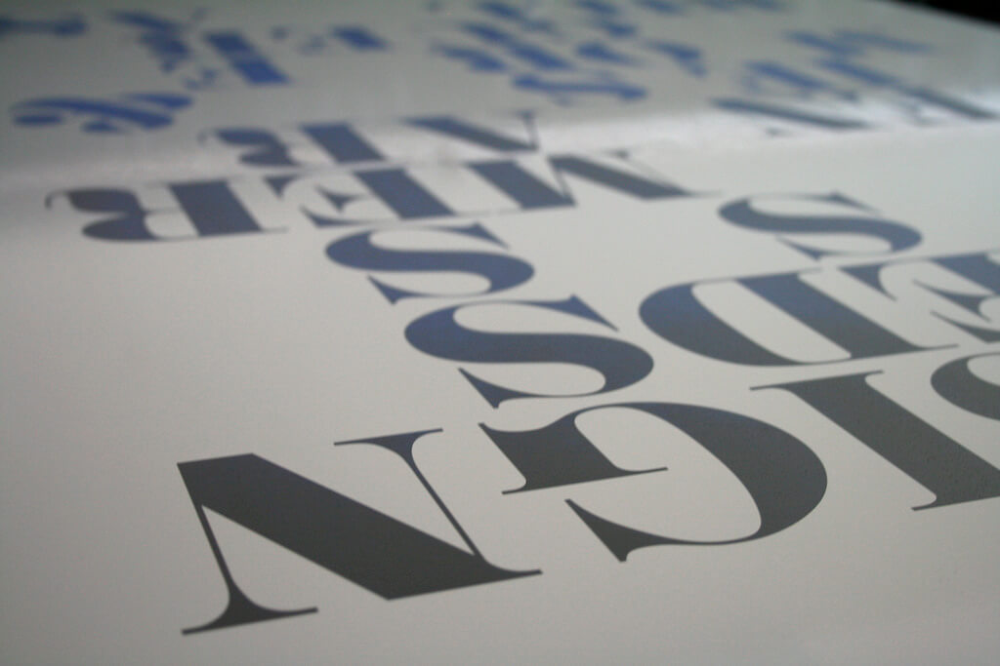

Add a picture to this page's **Page Media**, then place it with ``. An italic line right below it becomes its caption.

*Photo by Pat Armstrong, Flickr.com – replace this picture and credit with your own*

## A Video

Paste a YouTube address into the video shortcode below, in place of this one:

[youtube]https://www.youtube.com/watch?v=BrVnBdW6_rE[/youtube]

*Usability Testing, by AmberlightUX on YouTube*

## Slides

Most slide tools – Google Slides, PowerPoint online, Canva and others – give you an embed address when you share or publish a deck. Paste it into the iframe shortcode below, in place of these placeholder slides, and give it a short title for screen readers:

[iframe url="https://docs.google.com/presentation/d/e/2PACX-1vSPiOUzmRG4EB6ng8KQgOwZEbVuN2u1d5tGVTiAyzlVuO_o4Zjyli3oAf_U_CqXml_6GMUBR9nUyEYb/embed?start=false&loop=false&delayms=3000" title="Placeholder slides"]

> [!TIP]
> A callout like this one starts with `> [!TIP]`. There's also `[!NOTE]`, `[!IMPORTANT]`, `[!WARNING]` and `[!CAUTION]`.

To add a module, use **Add Page** inside **Modules**, or **Copy page** on one you've already written. Modules appear in the order of their folders, such as `02.module-01`.
